# Nairobi Air-Quality Anomaly Detection

**An explainable, ensemble-based ML system that detects anomalous hourly PM2.5 readings in Nairobi's low-cost sensor network and triages each one as a likely pollution event or a likely sensor fault.**

Baya Isaac (222327) · MSc Data Science & Analytics · DSA 8401 Applied Machine Learning · Strathmore University

---

## What it does

Nairobi relies on low-cost optical sensors (sensors.AFRICA) for long-term air-quality data. They are noisy and humidity-sensitive, and a faulty device can look like a pollution spike. This system:

1. **Rebuilds the dataset** from the raw sensors.AFRICA archive: about 292,000 hourly readings from 53 sensor sites, 2019–2026.
2. **Learns what is normal** for each neighbourhood, local hour and weekday, and scores how far each reading departs from it.
3. **Detects anomalies** with five unsupervised detectors (statistical MAD, LOF, One-Class SVM, DBSCAN, STL). Their consensus trains one fast SMOTE-balanced XGBoost scorer.
4. **Explains and triages every flag.** Each flag gets SHAP top-3 drivers in plain language, a severity tier (Watch / Alert / Critical), and a likely cause from neighbour evidence (genuine / likely sensor fault / unverifiable). It also gets a humidity-artefact warning and the stakeholder it should be routed to.
5. **Serves it** from one Docker container: a landing page, an interactive analyzer and the REST API, deployable free on Render. There is also a batch CLI and a standalone Streamlit app.

## Architecture

```mermaid
flowchart LR
    subgraph DATA["Data pipeline · src/airq/data · notebook 01"]
        A[openAFRICA CKAN<br/>monthly raw CSVs] --> B[tidy + float32<br/>dedupe, floor to hour]
        B --> C[hourly means per location<br/>running sums / counts<br/>SENSOR_TYPE combos]
        C --> D[coordinates +<br/>reverse geocoding<br/>frozen cache]
        D --> E[(hourly dataset<br/>csv.gz / xlsx)]
    end
    subgraph TRAIN["Training pipeline · src/airq/train.py · notebook 02"]
        E --> F[clean · UTC→local<br/>sensor-range faults aside]
        F --> G[features · past-only rolling<br/>neighbourhood features]
        G --> H[temporal split<br/>seasonal baseline residual]
        H --> I[5 detectors →<br/>consensus pseudo-label]
        I --> J[SMOTE + XGBoost<br/>meta-model]
        J --> K[threshold · severity<br/>cause model · metrics]
    end
    K --> M[(models/*.joblib<br/>model_config.json<br/>reports/metrics.json)]
    subgraph SERVE["Serving · src/airq/scoring.py"]
        M --> N[AnomalyScorer]
        N --> O[FastAPI :8000<br/>/predict · /predict/file]
        N --> P[batch CLI<br/>airq predict]
        O --> Q[Streamlit dashboard :8501]
    end
```



The same `AnomalyScorer` code path serves the batch CLI, the API and the notebook's parity check (Section 18 of notebook 02). This guarantees that served features equal training features.

## Repository layout

```
├── README.md · AI_USE.md · Makefile · pyproject.toml · requirements*.txt
├── configs/config.yaml          single source of settings (paths, splits, thresholds)
├── src/airq/
│   ├── data/ingest.py           raw archive -> hourly dataset (download, tidy, aggregate, save)
│   ├── data/geocode.py          Nominatim reverse geocoding with frozen cache
│   ├── data/validate.py         schema checks, comparison with the published file
│   ├── preprocess.py            cleaning, imputation, features, seasonal baseline
│   ├── detectors.py             MAD, LOF, One-Class SVM, DBSCAN, STL
│   ├── model.py                 feature pruning, SMOTE+XGBoost, StratifiedGroupKFold, threshold
│   ├── triage.py                severity, neighbour-evidence cause, cause random forest
│   ├── evaluate.py              corroboration, ablation, documented events, Moran's I
│   ├── scoring.py               AnomalyScorer used by CLI, API and notebook
│   ├── train.py                 end-to-end training script
│   └── pipeline.py              CLI: ingest | validate-data | train | predict | all
├── api/main.py, api/web.py      FastAPI service, website routes
├── web/                         landing page and analyzer (HTML/CSS/JS, bundled GSAP + Plotly)
├── render.yaml                  Render Blueprint (one Docker web service)
├── streamlit_app/               standalone Streamlit app (Streamlit Community Cloud)
├── dashboard/                   Streamlit client of the API (+ Dockerfile)
├── Dockerfile · Dockerfile.pipeline · docker-compose.yml
├── notebooks/
│   ├── 01_data_pipeline.ipynb   rebuilds the dataset from the raw archive
│   └── 02_anomaly_detection.ipynb   analysis, evaluation, justification, parity check
├── data/
│   ├── processed/nairobi_hourly_airquality.csv.gz   the hourly dataset (same content as the .xlsx)
│   ├── reference/sensor_locations.csv               frozen location -> neighbourhood names
│   ├── reference/documented_events.csv              event windows for external validation
│   ├── sample_raw/                                  archive-format sample (offline demo + tests)
│   └── sample/                                      example API requests (JSON, CSV)
├── models/                      trained artifacts (committed; retrain with `airq train`)
├── reports/metrics.json         all metrics of the committed models
├── scripts/make_sample_raw.py   writes archive-format sample files
├── tests/                       data-pipeline round trip, leakage tests, API tests
├── docs/REPORT.md               final report
└── .github/workflows/ci.yml     tests + Docker build on every push
```

## Quick start

### Option 1: Docker (recommended for reviewers)

```bash
docker compose up --build
# Website:    http://localhost:8000      (analyzer at /app, API docs at /docs)
# Streamlit:  http://localhost:8501
```

Send readings to the API:

```bash
curl -X POST http://localhost:8000/predict \
     -H "Content-Type: application/json" \
     -d @data/sample/sample_request.json

curl -X POST "http://localhost:8000/predict/file?explain=true&only_flagged=true" \
     -F "file=@data/sample/sample_request.csv"
```

Retrain or rebuild the data inside the pipeline container (results land in your local `models/`, `reports/`, `data/`):

```bash
docker compose run --rm pipeline train
docker compose run --rm pipeline ingest --raw-dir data/sample_raw --no-network --no-xlsx
docker compose run --rm pipeline ingest --download          # full archive, needs internet
```

### Option 2: Local Python (3.12)

```bash
python -m venv .venv && source .venv/bin/activate     # Windows: .venv\Scripts\activate
pip install -r requirements-dev.txt
pip install -e .

python -m airq.pipeline train                          # ~2-3 min on one CPU core
python -m airq.pipeline predict --input data/sample/sample_request.csv \
       --output reports/sample_predictions.csv --explain
pytest -q
uvicorn api.main:app --port 8000
```

## Reproducing everything from scratch

| Step | Command | Output |
|---|---|---|
| 1. Raw data | `python -m airq.pipeline ingest --download` | `data/raw/*.csv` (monthly archive) and `data/processed/nairobi_hourly_airquality.csv.gz` + `.xlsx` |
| 1b. Offline alternative | `python -m airq.pipeline ingest --raw-dir data/sample_raw --no-network --no-xlsx` | Rebuilds the two sample months; compare with `validate-data` |
| 2. Check the data | `python -m airq.pipeline validate-data --reference path/to/published.xlsx` | Row coverage and value agreement |
| 3. Train | `python -m airq.pipeline train` | `models/`, `reports/metrics.json`, `reports/scored_val_test.csv.gz` |
| 4. Serve | `docker compose up --build` | API + dashboard |
| 5. Analyse | run `notebooks/02_anomaly_detection.ipynb` | Figures, evaluation, parity check against `models/` |

Everything learned from data (imputation medians, baseline, detector parameters, scalers, threshold) is fitted on the training period only. `model_config.json` records the SHA-256 of the training file and the package versions.

> **Note on step 1.** The download URL comes from the openAFRICA CKAN API (`configs/config.yaml → ingest`). If the dataset id changes, the code falls back to a CKAN search; you can also drop monthly CSVs into `data/raw/` manually. Neighbourhood names come from a frozen cache, so a rebuild reproduces the published names even though OpenStreetMap changes. The round trip on the sample months matches the published file exactly (`tests/test_ingest.py`).

## Website and interactive analyzer (Hewa)

The API container also serves the public website, so one Docker service on Render is the whole product:

| Path | What it is |
|---|---|
| `/` | Landing page: Nairobi skyline under a particle haze driven by a replay of real readings from sensor 3576 (12–17 May 2024), the five-step pipeline as a pinned scroll sequence (GSAP ScrollTrigger), and honest validation/test results |
| `/app` | Interactive analyzer: pick a bundled sample or upload a CSV/XLSX; move the alert threshold and severity rules and every view updates instantly; timeline with flags, flags table (filter, sort, CSV download), "why it was flagged" with SHAP reasons and neighbouring sensors, per-sensor health and distributions, model card |
| `/docs` | Interactive API documentation (FastAPI) |
| `/predict`, `/predict/file` | REST endpoints |

The server scores data once (probability floor 0.5, with SHAP explanations for every reading above it). The browser then re-applies the threshold, severity and cause rules, which mirror `src/airq/triage.py`. `tests/test_api.py::test_browser_rules_match_server` checks that they agree with the server's labels.

Front-end files live in `web/` (plain HTML, CSS and JavaScript, no build step). GSAP 3.13 (standard no-charge licence), Plotly.js 2.35 (MIT) and the Big Shoulders Display and Public Sans fonts (SIL OFL) are bundled in `web/static`, so the site does not depend on outside CDNs. Photos are hotlinked from Unsplash under the Unsplash License and credited in the page footer.

## Deploying on Render (Docker)

`render.yaml` is a Render Blueprint, so Render builds the `Dockerfile` and configures the service itself.

1. Sign in at https://render.com with GitHub.
2. Choose **New → Blueprint**, pick `BayaJr10/anomaly-detection`, and click **Apply**.
3. Wait for the first build (about 8–12 minutes: it installs the Python packages). The site is then live at `https://hewa-airq.onrender.com` or the URL Render shows.

Without the Blueprint: **New → Web Service → Docker**, instance type **Free**, health check path `/health`. The container listens on `$PORT`, which Render sets automatically.

The free instance has 512 MB of memory; the service peaks at about 360 MB, and uploads are capped at 20,000 rows (`AIRQ_MAX_UPLOAD_ROWS`). Free services sleep after 15 minutes without traffic, so the first visit afterwards takes about a minute. Open the site shortly before presenting. Every push to `main` redeploys automatically.

## Streamlit app (alternative demo)

`streamlit_app/app.py` loads the trained models directly, so it needs no API. It uses the same `AnomalyScorer` as the API and the batch CLI, so it gives identical results.

| Tab | What it shows |
|---|---|
| Time series | PM2.5 against the usual level for each sensor, flags coloured by severity; flags by severity × cause; flag rate by weekday × hour |
| Flagged readings | Filterable table (severity, cause, neighbourhood) with CSV download |
| Explain a flag | Plain-language reason, SHAP bar chart, neighbour evidence, cause, routing, and the ±48 h neighbourhood plot |
| Sensor health | Per-sensor flag and fault counts, last seen, and a map |
| Model card | Features, threshold, validation/test metrics and caveats |

Sidebar controls set the probability cutoff and the severity thresholds. Two bundled samples are included, or you can upload any CSV/XLSX in the dataset format.

**Run locally**

```bash
pip install -r streamlit_app/requirements.txt
streamlit run streamlit_app/app.py
```

**Deploy on Streamlit Community Cloud (free)**

1. Push this repository to GitHub (public, or private with Streamlit access granted). Include `models/`, `configs/`, `src/`, `data/sample/` and `reports/metrics.json`.
2. Go to https://share.streamlit.io, sign in with GitHub and choose **Create app → Deploy a public app from GitHub**.
3. Pick the repository and branch, and set **Main file path** to `streamlit_app/app.py`.
4. Open **Advanced settings** and choose **Python 3.12**, the version the models were trained with.
5. Click **Deploy**. The first build installs `streamlit_app/requirements.txt` and takes about 3–5 minutes.

Apps sleep after a period without visitors; open the link a few minutes before presenting.

## API reference

| Method | Path | Body / params | Returns |
|---|---|---|---|
| GET | `/health` | | status, model loaded, threshold |
| GET | `/model-info` | | features, threshold, data hash, versions, validation/test metrics |
| POST | `/predict` | `{"readings": [...], "explain": bool, "only_flagged": bool, "threshold": float?, "severity": {...}?}` | one prediction per reading |
| POST | `/predict/file` | multipart CSV/XLSX in the dataset format; `?explain=&only_flagged=&threshold=&output=json\|csv` | JSON or CSV |

**Input columns:** `LOCATION`, `NEIGHBORHOOD`, `PM25`, `PM10`, and `DATETIME` (UTC) or `DATE` + `TIME` (UTC, as in the dataset). `PM1`, `HUMIDITY` and `TEMPERATURE` are optional. Send at least the previous 72 readings per sensor so rolling features are complete, and all sensors for the same hours so neighbour evidence is available.

**Each prediction contains:** `DATETIME_UTC`, `DATETIME_LOCAL`, `baseline`, `residual`, `robust_z`, `anomaly_probability`, `is_anomaly`, `rule` (`meta_model` or `pm_above_sensor_range`), `severity`, `cause_label`, `cause_model_guess` (+ confidence, for single-sensor flags), `sensors_in_neighbourhood`, `humidity_artefact_risk`, `route_to`, and, with `explain=true`, `explanation` and `top_drivers`.

## Results (committed models)

| | Validation 2024 | Test 2025–26 (locked) |
|---|---|---|
| Rows / sensors | 21,128 / 12 | 14,824 / 7 |
| Pseudo-positive rate | 1.09% | 0.55% |
| ROC-AUC | 0.994 | 0.959 |
| PR-AUC | 0.852 | 0.448 |
| F1 at frozen threshold (0.970) | 0.811 | 0.455 |

Training CV (StratifiedGroupKFold by sensor): ROC-AUC 0.991 ± 0.008, PR-AUC 0.821 ± 0.098. All labels are detector-consensus pseudo-labels; see `docs/REPORT.md` for what these numbers do and do not show.

## Configuration

All settings live in `configs/config.yaml`: archive window, split dates (local time), cleaning bounds, detector parameters, model hyper-parameters, severity thresholds and the neighbour-support level. Override the config path with `AIRQ_CONFIG=...`, the repository root with `AIRQ_ROOT=...`, and the models directory for the API with `AIRQ_MODELS_DIR=...`.

## Documents

* `docs/REPORT.md`: final report covering problem framing, technique justification, results, limitations and real-world relevance.
* `AI_USE.md`: disclosure of AI assistance.
